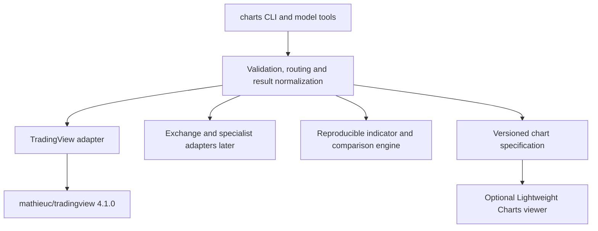

# Charts: proposed first release

This is the original wider roadmap, not the current command reference. The Mathieu-backed CLI/MCP now implements provider reads, studies/reports, native callback authorization and bounded stream samples. The [current README](../README.md) and `charts tools` define the actual 27 operations. Local calculations, comparisons, local watchlist writes, a visual viewer and additional providers remain future work. The [provider assessment](provider-assessment.md) also corrects the initially missed official TradingView MCP service.

## Product boundary

One app named `charts`, exposing the same operations through a JSON CLI and model tool definitions. Start with a complete read-and-analysis workflow: find the exact market, fetch data, inspect freshness/coverage, calculate supported indicators, compare timeframes, screen instruments, and produce a portable chart dataset.

Provider choice belongs below this interface. A user can request a venue-specific series and see its source without having to orchestrate unrelated provider CLIs. Cross-provider comparisons must preserve distinct venues and contracts.

## Application layers



Use the repo's native Node command patterns and installer conventions. The TradingView package is an internal dependency, not the public application API. Keep its Pine identifiers, quote abbreviations and timeframe encodings inside the adapter. Prefer upstream fixes over maintaining an independent fork unless a specific blocking issue requires one.

Suggested implementation layout:

```text
charts/
  bin/charts
  src/cli.mjs
  src/tools.mjs
  src/core/                 # instruments, schemas, routing, errors and provenance
  src/providers/tradingview/
  src/analysis/             # supported calculations and timestamp alignment
  src/chart-spec/           # portable datasets, panes and overlays
  test/
  docs/
  research/                # bounded developer probes, never runtime prerequisites
```

Start small: provider contracts for symbol search/resolve, quote snapshots, bars and streams; separate optional contracts for screening, studies, account lists and specialist metrics. Unsupported capabilities return a structured result. Avoid building a generic plugin marketplace before there is a second concrete provider.

## Proposed command and tool surface

| CLI operation | Model tool | Expected result |
| --- | --- | --- |
| `charts state` | `charts_get_state` | Enabled providers, capabilities, authentication state and availability; no secrets |
| `charts providers` | `charts_list_providers` | Supported operations and data modes by provider |
| `charts symbols search QUERY` | `charts_search_symbols` | Bounded matches with venue, currency and instrument type |
| `charts symbols resolve SYMBOL` | `charts_resolve_symbol` | Stable instrument identity, sessions, timezone and price/volume units |
| `charts quote SYMBOL...` | `charts_get_quotes` | Timestamped quotes with source and reported feed mode |
| `charts candles SYMBOL` | `charts_get_candles` | OHLCV plus requested/actual range and coverage status |
| `charts technicals SYMBOL` | `charts_get_technicals` | Source-labelled technical ratings and supported local calculations |
| `charts indicators search QUERY` | `charts_search_indicators` | Built-in/community definitions and known access requirements |
| `charts indicators values SYMBOL` | `charts_get_indicator_values` | Timestamp-aligned study values, inputs, version and calculation engine |
| `charts screener fields` | `charts_list_screener_fields` | Supported field metadata, universe and timeframe availability |
| `charts screen` | `charts_screen` | Explicitly bounded snapshot pages, filters, sorting and field provenance |
| `charts watchlist ...` | `charts_watchlist_*` | App-owned local lists; account-list reads remain a distinct operation |
| `charts compare SYMBOL...` | `charts_compare` | Aligned returns, relative strength and timeframe comparisons with stated methodology |
| `charts chart SYMBOL` | `charts_build_chart` | Versioned chart specification with data references or bounded inline data |
| `charts stream ...` | Bounded stream tools | NDJSON for CLI; finite, cancellable subscriptions or bounded samples for model clients |

The table retains the original proposed names; current names and arguments are in `charts tools`. Keep tools task-sized and schema-bound; do not expose arbitrary JavaScript or raw endpoint invocation. The first rendered viewer can consume the chart specification without adding a browser dependency to the data service.

## Data contract

Every response should include `status` and `message`, plus source and coverage information when data is returned. For example:

```json
{
  "status": "ok",
  "message": "20 hourly bars returned",
  "provider": "tradingview",
  "instrument": {
    "providerSymbol": "COINBASE:BTCUSD",
    "venue": "COINBASE",
    "marketType": "spot",
    "base": "BTC",
    "quote": "USD"
  },
  "fetchedAt": "<UTC timestamp>",
  "feed": { "updateMode": "streaming", "delaySeconds": null },
  "coverage": {
    "requestedBars": 20,
    "returnedBars": 20,
    "complete": null,
    "firstBarTime": "<UTC bar-open time>",
    "lastBarTime": "<UTC bar-open time>"
  },
  "warnings": [],
  "data": []
}
```

This is a schema sketch, not actual market data. `null` means unknown, not zero. `streaming` reports the provider's mode and does not independently prove latency or entitlement. A returned count alone does not prove gap-free history.

Store both retrieval time and the provider's data time when supplied. Preserve the time unit, session calendar, venue timezone, adjustment policy and volume units. Do not equate spot BTC/USD, BTC/USDT, perpetuals and continuous futures. Canonical identity must also support contract expiry and settlement currency when those sources are added.

Normalize CLI timeframes centrally, with unambiguous month/minute handling. Return candles in ascending order with a documented policy for the current unfinished bar. Synthetic bars such as Heikin Ashi must be identified and not silently used as executable market prices. Align study values by timestamp, including warm-up/null values, rather than zipping arrays.

Cache keys must include provider, instrument, timeframe, session, adjustment, currency and account scope where applicable. A fallback must disclose its source and must not silently substitute another exchange. Structured errors should distinguish invalid symbols, missing capabilities, authentication/entitlement failures, rate limits, timeout, protocol changes and partial data.

## Authentication and operations

The anonymous read path must run headlessly without a session, browser, emulator or API key. Treat account access as an additional capability with independent validation. The upstream password login cannot complete 2FA/CAPTCHA. The native callback handoff, independent account validation and authenticated reads have now passed on an Orin; the user's separate device must receive the native callback. Its extra native-app 2FA step is not implemented. Do not promise device-code/OAuth login that TradingView has not documented.

When account integration is built, persist only session material with restrictive permissions, redact it from tool results and logs, and expose expiration as actionable state. Login occurs only on the user's separate device. Never run a browser, desktop app, CDP session or emulator on the host, including for authentication. See the [actual native callback protocol](auth-protocol.md). Do not require HAR files, sniffers or manual cookie pasting as the normal user flow.

Bound requests by bars, symbols, rows, duration and concurrency. Current commands report rate limits without automatic retries and never replay an uncertain credential exchange. Sustained streaming would need idle-data detection, reconnection and gap filling; current finite samples instead close and report failures with orderly process/signal cleanup. Long-term monitoring requires an explicit running service and persistence; a completed one-shot CLI command must not pretend to keep watching.

Keep v1 focused on reads, analysis and app-owned chart/list state. TradingView-account mutations, alert creation, access-management operations and order execution are separate future features with separate contracts. Local lists are not automatically synchronized with TradingView.

## Delivery order and acceptance criteria

| Milestone | Complete outcome | Evidence needed |
| --- | --- | --- |
| 1. Anonymous data core | Installable `charts` CLI, state/tools, discovery, quotes, bounded candles, technical ratings and screening | Deterministic request/parser tests plus bounded live checks; unknown symbols, malformed payloads, partial history and timeouts must produce distinct outcomes |
| 2. Complete analysis workflow | Supported local indicators, multi-timeframe comparisons, local watchlists, chart specifications and finite streaming | Timestamp/warm-up fixtures; closed-bar checks; stale-feed and disconnect recovery; chart data round-trip; human comparison with matching TradingView venue/timeframe/settings |
| 3. Optional visual viewer | Interactive candles, volume, indicator panes, overlays and synchronized views using Lightweight Charts | Confirm viewer reflects the same exported dataset, handles gaps/timezones and preserves attribution; it must not fetch a different hidden feed |
| 4. Account capabilities | Proven session lifecycle, Pine-study results and account-watchlist reads | Real account tests with human UI verification, including a populated list and an accessible script; expiration, 2FA/CAPTCHA and access denial remain clear |
| 5. Crypto expansion | A second actual provider, then funding/OI/basis/order-flow or other prioritized datasets | Explicit units, venue/contract mapping, historical retention, provenance and independently checked calculations |

The first release can ship an honest, complete anonymous research workflow once milestones 1 and 2 pass; it must not advertise full TradingView account support. The viewer can follow when visual output is needed. Account features should become available only when their own integration checks pass, rather than delaying the entire app or presenting placeholders as working tools.

For backtesting later, distinguish local strategies over a frozen dataset from TradingView's server-generated Pine strategy reports. Preserve fees, slippage, execution assumptions, sample windows and open-position treatment. A local engine is not proof of TradingView parity or access to Deep Backtesting.

## Questions already answered and work still open

- App name and public interface: `charts`, aggregating providers under one CLI/tool surface.
- First technical adapter: wrap the exact tested `@mathieuc/tradingview@4.1.0` package.
- Rendering direction: official Lightweight Charts; Advanced Charts only if its additional UI justifies access/licensing and integration costs.
- Additional Python wrappers: references for now, not redundant runtime dependencies.
- Deployment baseline is native Node 24.21.0. Anonymous tools have deterministic and bounded live evidence. A real native callback exchange, saved-session reuse, watchlist read and authenticated quote passed on an Orin, with peak RSS measured at 71.8 MiB for an anonymous quote and 104.6 MiB for the authenticated validation/read sequence. See the [Orin test record](../research/orin-auth-results.json). Still open: extra native-app 2FA, feed permissions for distribution, sustained streaming, GUI parity and prioritized specialist crypto datasets.
